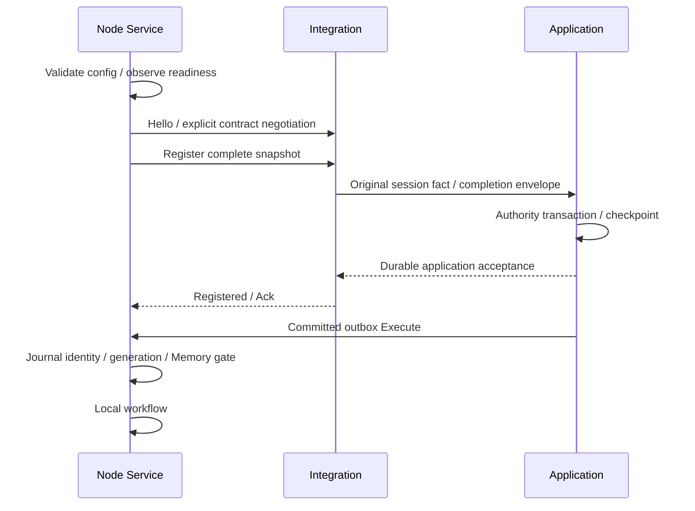

# Integration and Node Service

Integration owns formal gRPC/sessions/routes. Node Service compiles configuration, keeps its journal and invokes generic drivers to reach Local EAIOS.

## Responsibilities and key objects

GrpcIntegrationService, Node router, NodeServiceConfig, LocalIntegrationEngine and ExecutionJournal.

## Main flow

Observe readiness before Register; Registered/Ack waits for durable application acceptance. Execute journals before Local How; duplicates retain original identity/budget.

## Code entrypoints

- [Primary entry](https://github.com/Farewell-CK/RoboGuide/blob/main/core/integration/src/lib.rs): `core/integration/src/lib.rs`.
- [Collaborating entry](https://github.com/Farewell-CK/RoboGuide/blob/main/core/node-service/src/lib.rs): `core/node-service/src/lib.rs`.

## Implementation status

[Status](../status.md) records actual paths and remaining work; [Reference](../reference.md) generates versions. A module's existence does not establish full stage or device acceptance.

## Validation and diagnosis

Inspect original identity/plan/attempt, current policy and deadlines before upstream/downstream transactions and receipts. Rejection, timeout, replay and restart preserve original evidence. Explicit software configurations, FakeNodes and protocol fixtures are not devices.

## Related boundaries

[Architecture and authority](../architecture-tour.md) · [Concepts](../concepts.md) · [Lifecycle](../lifecycle.md) · [Integration](../integration-guide.md) · [State and Memory](../state-memory.md)

## Detailed flow reference

### Admission, ACK and local journal

Wire v0.4, semantic Node Contract and config schema are separate version axes. The basic handshake explicitly negotiates v0.6. Memory/safety profiles require their declared contracts, never inferred metadata permission.

The Node journal holds original sibling/inode leases across clones and fences old writers. Local protocol drivers are generic; vendor semantics remain in deployment workflows.

Original receipts, terminals, stop proofs and provider revokes travel as separate evidence. gRPC delivery is not business completion.
