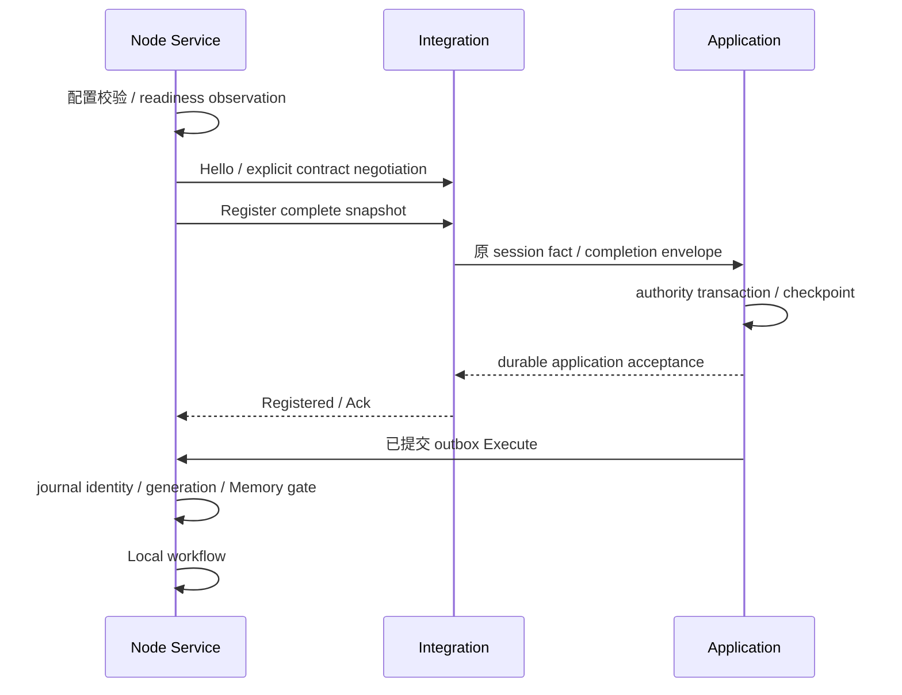

# Integration 与 Node Service

Integration 负责正式 gRPC/session/route；Node Service 编译配置、保留 journal 并调用通用 driver 连接 Local EAIOS。

## 职责与关键对象

GrpcIntegrationService、Node router、NodeServiceConfig、LocalIntegrationEngine、ExecutionJournal。

## 主流程

先 observation readiness 再 Register；Registered/Ack 等应用 durable acceptance。Execute 先 journal 再 Local How，重复命令保留原 identity/budget。

## 代码入口

- [主入口](https://github.com/Farewell-CK/RoboGuide/blob/main/core/integration/src/lib.rs)：`core/integration/src/lib.rs`。
- [协作入口](https://github.com/Farewell-CK/RoboGuide/blob/main/core/node-service/src/lib.rs)：`core/node-service/src/lib.rs`。

## 实现状态

当前实际调用链与剩余工作统一记录在[实现状态](../status.md)，版本由[参考页](../reference.md)生成。本模块的存在不代表完整阶段或设备验收完成。

## 验证与排查

先检查原 identity/plan/attempt、当前 policy 与期限，再查上下游事务和 receipt。拒绝、超时、重放与重启必须保留原证据。测试使用显式软件配置，不把 FakeNode 或协议 fixture 当作设备。

## 相关边界

[架构与权威](../architecture-tour.md) · [概念](../concepts.md) · [生命周期](../lifecycle.md) · [接入指南](../integration-guide.md) · [State 与 Memory](../state-memory.md)

## 调用链详解

### 接纳、ACK 与本地 journal

wire v0.4、语义 Node Contract 和 config schema 是不同版本轴。基础握手示例明确协商 v0.6；Memory/安全 profile 显式采用新合同，不根据 metadata 猜权限。

Node journal 使用原 sibling/inode leases，克隆保留 lease；schema fence 拒绝旧 writer。Local EAIOS 的协议 driver 是通用实现，厂商语义在部署 workflow 内维护。

原命令 receipt、terminal、stop proof 和 provider revoke 通过不同证据路径返回，不能把 gRPC 送达等同于业务完成。
