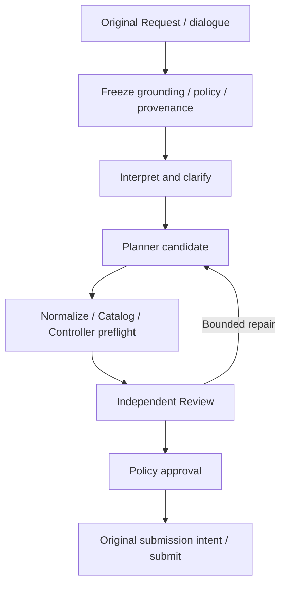

# Mission Intelligence

Turns user objectives into clarified, Reviewed and approved complete plans while retaining Requests, raw provider responses and provenance.

## Responsibilities and key objects

RequestEngine, GroundingContextSnapshot, Planner/Reviewer/Repairer; runtime work claims, nonces and original objectives.

## Main flow

Freeze grounding/policy → interpret → draft → preflight/Review → bounded repair/approval → submit. Interrupted submission/provider outcomes remain uncertain and use read-only original-result observation.

## Code entrypoints

- [Primary entry](https://github.com/Farewell-CK/RoboGuide/blob/main/mission/src/mission/request_engine.py): `mission/src/mission/request_engine.py`.
- [Collaborating entry](https://github.com/Farewell-CK/RoboGuide/blob/main/mission/src/mission/runtime_replanning.py): `mission/src/mission/runtime_replanning.py`.

## Implementation status

[Status](../status.md) records actual paths and remaining work; [Reference](../reference.md) generates versions. A module's existence does not establish full stage or device acceptance.

## Validation and diagnosis

Inspect original identity/plan/attempt, current policy and deadlines before upstream/downstream transactions and receipts. Rejection, timeout, replay and restart preserve original evidence. Explicit software configurations, FakeNodes and protocol fixtures are not devices.

## Related boundaries

[Architecture and authority](../architecture-tour.md) · [Concepts](../concepts.md) · [Lifecycle](../lifecycle.md) · [Integration](../integration-guide.md) · [State and Memory](../state-memory.md)

## Detailed flow reference

### Requests and runtime work

Missing current Nodes is a scheduling condition, not permission for Interpreter to invent entities or reject semantics. Retain draft errors separately from provider/HTTP/source failures; regeneration uses only the original bounded draft budget.

Runtime workers discover original Requests from committed Generating tickets filtered by stable principal/tenant. Original claims/nonces and SQL intents precede provider I/O. Uncertain calls use read-only reconciliation; replacing stores/nonces cannot repeat them. Candidates/advice grant no Control permission; independent Review and original-goal proofs remain mandatory.

Code paths: `request_engine.py`, `plan_validation.py`, `runtime_replanning.py`, `runtime_work_store.py`.
