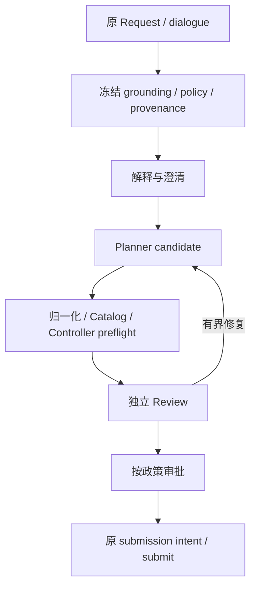

# Mission Intelligence

把用户目标转成经过澄清、Review 和审批的完整计划，并保留 Request、原始 provider 输出与 provenance。

## 职责与关键对象

RequestEngine、GroundingContextSnapshot、Planner/Reviewer/Repairer；运行期 work claim、nonce 与原目标。

## 主流程

冻结 grounding 与 policy → 解释 → 草案 → preflight/Review → 必要修复/审批 → submit。interrupted submission/provider outcomes 保持不确定，只读核对原结果。

## 代码入口

- [主入口](https://github.com/Farewell-CK/RoboGuide/blob/main/mission/src/mission/request_engine.py)：`mission/src/mission/request_engine.py`。
- [协作入口](https://github.com/Farewell-CK/RoboGuide/blob/main/mission/src/mission/runtime_replanning.py)：`mission/src/mission/runtime_replanning.py`。

## 实现状态

当前实际调用链与剩余工作统一记录在[实现状态](../status.md)，版本由[参考页](../reference.md)生成。本模块的存在不代表完整阶段或设备验收完成。

## 验证与排查

先检查原 identity/plan/attempt、当前 policy 与期限，再查上下游事务和 receipt。拒绝、超时、重放与重启必须保留原证据。测试使用显式软件配置，不把 FakeNode 或协议 fixture 当作设备。

## 相关边界

[架构与权威](../architecture-tour.md) · [概念](../concepts.md) · [生命周期](../lifecycle.md) · [接入指南](../integration-guide.md) · [State 与 Memory](../state-memory.md)

## 调用链详解

### 请求与运行期工作

无当前 Node 是调度条件，不是让 Interpreter 编造实体或语义拒绝的理由。草案错误与 provider/HTTP/source 错误分别保留；只有原预算允许的草案恢复可以重新生成。

运行期 worker 从已提交 Generating ticket 按 stable principal/tenant 发现原 Request。原 claim/nonce 与 SQL intent 先于 provider I/O；不确定调用只读对账，不换 store 或 nonce 重做。候选与建议没有 Control 权限，独立 Review 和原目标 proof 仍是必需门禁。

代码路径：`request_engine.py`、`plan_validation.py`、`runtime_replanning.py`、`runtime_work_store.py`。
