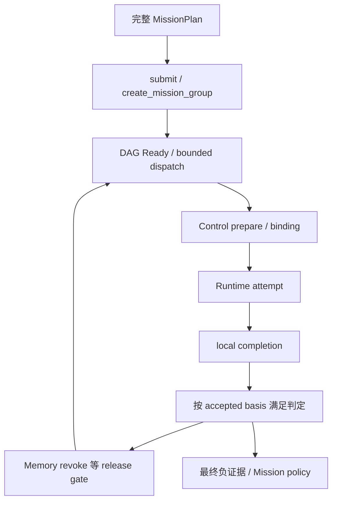

# Mission Orchestration

拥有已接受计划、DAG readiness、Task satisfaction、Mission lifecycle、hold 和逻辑 dispatch policy。

## 职责与关键对象

MissionOrchestrator、MissionExecution、IntegrationRuntimeBridge；桥接不是第二份 execution authority。

## 主流程

submit 创建 Group 与全部 Tasks → 推进 Ready → 调 Control/Runtime → local completion 后等 satisfaction → release gate → DAG。修订保留原目标与旧事实。

## 代码入口

- [主入口](https://github.com/Farewell-CK/RoboGuide/blob/main/core/orchestration/src/lib.rs)：`core/orchestration/src/lib.rs`。
- [协作入口](https://github.com/Farewell-CK/RoboGuide/blob/main/core/orchestration/src/mission/lifecycle.rs)：`core/orchestration/src/mission/lifecycle.rs`。

## 实现状态

当前实际调用链与剩余工作统一记录在[实现状态](../status.md)，版本由[参考页](../reference.md)生成。本模块的存在不代表完整阶段或设备验收完成。

## 验证与排查

先检查原 identity/plan/attempt、当前 policy 与期限，再查上下游事务和 receipt。拒绝、超时、重放与重启必须保留原证据。测试使用显式软件配置，不把 FakeNode 或协议 fixture 当作设备。

## 相关边界

[架构与权威](../architecture-tour.md) · [概念](../concepts.md) · [生命周期](../lifecycle.md) · [接入指南](../integration-guide.md) · [State 与 Memory](../state-memory.md)

## 调用链详解

### 接纳、满足与版本修订

`mission/checkpoint.rs` 保存接纳计划与时间锚，`mission/lifecycle.rs` 把 completion 和 satisfaction 分开，`mission/revision.rs` 保留原目标与版本历史。`integration_bridge/` 组合传输事实与现有 Runtime，不另建 execution map。

调度不足保留 durable deferral，不阻塞其他 Mission。取消、hold、恢复与 revision 保留各自 gate；终态 evidence 不是所有情况下足够的停止或内容撤销证据。
