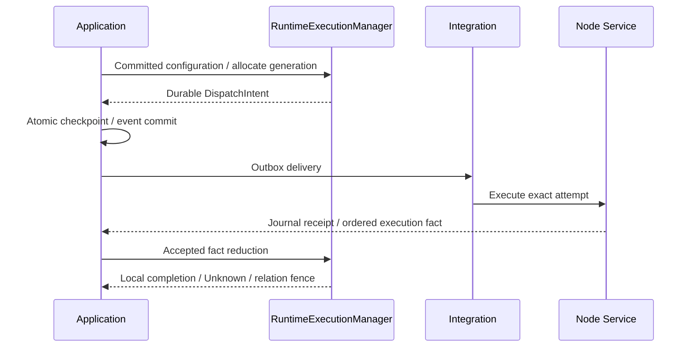

# Distributed Runtime

Maintains logical slots, physical attempts, generations, durable intents, ordered facts and relation fences for committed execution.

## Responsibilities and key objects

RuntimeExecutionManager, DispatchIntent, ExecutionStatus, ExecutionSlot, relation reducers and checkpoints.

## Main flow

Prepare exact attempts/intents → application commit → Node routing → identity-bound fact reduction. Unknown/relation violations fence success and continuation; stale actions never replay automatically.

## Code entrypoints

- [Primary entry](https://github.com/Farewell-CK/RoboGuide/blob/main/core/runtime/src/execution/mod.rs): `core/runtime/src/execution/mod.rs`.
- [Collaborating entry](https://github.com/Farewell-CK/RoboGuide/blob/main/core/runtime/src/relation/manager.rs): `core/runtime/src/relation/manager.rs`.

## Implementation status

[Status](../status.md) records actual paths and remaining work; [Reference](../reference.md) generates versions. A module's existence does not establish full stage or device acceptance.

## Validation and diagnosis

Inspect original identity/plan/attempt, current policy and deadlines before upstream/downstream transactions and receipts. Rejection, timeout, replay and restart preserve original evidence. Explicit software configurations, FakeNodes and protocol fixtures are not devices.

## Related boundaries

[Architecture and authority](../architecture-tour.md) · [Concepts](../concepts.md) · [Lifecycle](../lifecycle.md) · [Integration](../integration-guide.md) · [State and Memory](../state-memory.md)

## Detailed flow reference

### Stable slots and formal dispatch

A `(Group, Task, Role)` slot may retain multiple historical attempts. New attempts never overwrite original sessions/generations/results. Delivered means proven Node acceptance, not satisfaction.

`requires-active` reduces current execution state; `shared-spatial-reference` checks current attempt/owner/map revision/frame. Violated/Unknown fences need explicit acknowledgement even if the relation recovers. Peer readiness observes channels already established by Local EAIOS; Node Protocol carries no high-frequency peer data.

Restore clears process-local session anchors and retains nonterminal ambiguity as Unknown. It neither resends physical operations nor refreshes receive time.
