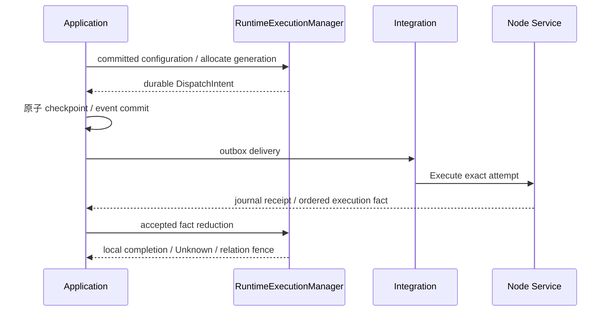

# Distributed Runtime

维护 committed execution 的 logical slots、physical attempts、generation、durable intents、ordered facts 与 relation fences。

## 职责与关键对象

RuntimeExecutionManager、DispatchIntent、ExecutionStatus、ExecutionSlot、relation reducer 与 checkpoint。

## 主流程

生成 exact attempt/intents → 应用持久提交 → Node 路由 → facts 按原身份归约。Unknown/关系违例 fence 成功与继续，不能自动重放旧动作。

## 代码入口

- [主入口](https://github.com/Farewell-CK/RoboGuide/blob/main/core/runtime/src/execution/mod.rs)：`core/runtime/src/execution/mod.rs`。
- [协作入口](https://github.com/Farewell-CK/RoboGuide/blob/main/core/runtime/src/relation/manager.rs)：`core/runtime/src/relation/manager.rs`。

## 实现状态

当前实际调用链与剩余工作统一记录在[实现状态](../status.md)，版本由[参考页](../reference.md)生成。本模块的存在不代表完整阶段或设备验收完成。

## 验证与排查

先检查原 identity/plan/attempt、当前 policy 与期限，再查上下游事务和 receipt。拒绝、超时、重放与重启必须保留原证据。测试使用显式软件配置，不把 FakeNode 或协议 fixture 当作设备。

## 相关边界

[架构与权威](../architecture-tour.md) · [概念](../concepts.md) · [生命周期](../lifecycle.md) · [接入指南](../integration-guide.md) · [State 与 Memory](../state-memory.md)

## 调用链详解

### 稳定槽位与正式派发

同一 `(Group, Task, Role)` 槽可以有多个历史 attempt；新 attempt 不覆盖原 session、generation 或终态。delivered 说明 Node 接纳已被证实，不代表 Task 满足。

`requires-active` 从当前 execution state 归约，`shared-spatial-reference` 核对当前 attempt/owner/map revision/frame。Violated/Unknown 的 fence 即使关系恢复也需显式确认解除。peer readiness 只观察 Local EAIOS 已建立的通道，Node Protocol 不传高频 peer data。

恢复清空进程本地 session anchor，原非终态保留 Unknown；不会因重启重新发送物理操作或刷新 receive time。
