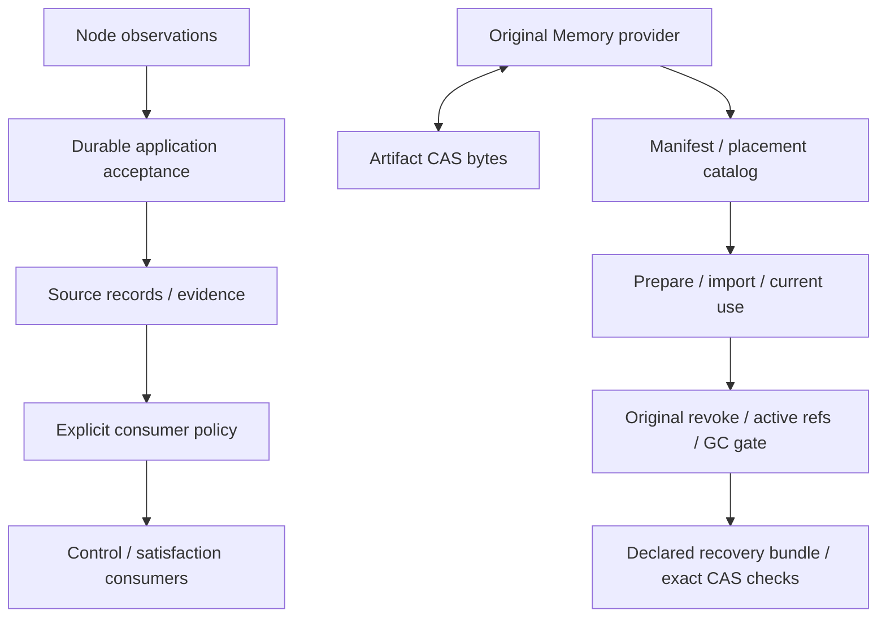

# State, Memory and Artifact

Stores attributed State, nonauthoritative projections, events/checkpoints and rebuildable catalogs. Artifact Store keeps opaque bytes; original providers retain content semantics.

## Responsibilities and key objects

StateRecord, Allocation projection, Memory/Map catalogs, SqliteEventLog and ArtifactBlobStore.

## Main flow

Application-accepted observations become source records consumed by explicit Control policy. Memory follows authorized prepare/import/use/revoke; recovery reconciles CAS and active references.

## Code entrypoints

- [Primary entry](https://github.com/Farewell-CK/RoboGuide/blob/main/core/state/src/lib.rs): `core/state/src/lib.rs`.
- [Collaborating entry](https://github.com/Farewell-CK/RoboGuide/blob/main/core/artifact-store/src/lib.rs): `core/artifact-store/src/lib.rs`.

## Implementation status

[Status](../status.md) records actual paths and remaining work; [Reference](../reference.md) generates versions. A module's existence does not establish full stage or device acceptance.

## Validation and diagnosis

Inspect original identity/plan/attempt, current policy and deadlines before upstream/downstream transactions and receipts. Rejection, timeout, replay and restart preserve original evidence. Explicit software configurations, FakeNodes and protocol fixtures are not devices.

## Related boundaries

[Architecture and authority](../architecture-tour.md) · [Concepts](../concepts.md) · [Lifecycle](../lifecycle.md) · [Integration](../integration-guide.md) · [State and Memory](../state-memory.md)

## Detailed flow reference

### Read projections and content gates

State API federates original Desired, Committed, Reported, Observed, Derived and Belief authorities without another write entrypoint. Allocation may lag and cannot grant or revoke Control ownership.

Artifact filesystem code handles digests, paths, streaming and durability. Application writers and original-provider lifecycle gates enforce content authority. Existing bytes cannot authorize aliases; Imported history cannot authorize a new Task.

Compact provider use/worker/map/handoff references conservatively gate GC. Recovery validates active refs against the same provider CAS; released history does not require already deleted bytes.
