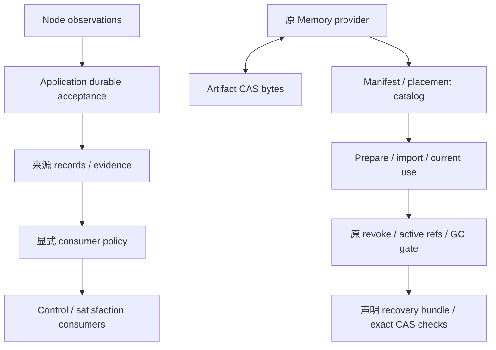

# State、Memory 与 Artifact

存储来源 State、非权威投影、事件/checkpoint 与可重建 catalog；Artifact Store 另存 opaque bytes，原 provider 保有内容语义。

## 职责与关键对象

StateRecord、Allocation projection、Memory/Map catalog、SqliteEventLog、ArtifactBlobStore。

## 主流程

来源 observation 经应用接纳进入记录；Control 显式 policy 消费。Memory 经授权准备/import/use/revoke；CAS 与 active refs 在恢复包内对账。

## 代码入口

- [主入口](https://github.com/Farewell-CK/RoboGuide/blob/main/core/state/src/lib.rs)：`core/state/src/lib.rs`。
- [协作入口](https://github.com/Farewell-CK/RoboGuide/blob/main/core/artifact-store/src/lib.rs)：`core/artifact-store/src/lib.rs`。

## 实现状态

当前实际调用链与剩余工作统一记录在[实现状态](../status.md)，版本由[参考页](../reference.md)生成。本模块的存在不代表完整阶段或设备验收完成。

## 验证与排查

先检查原 identity/plan/attempt、当前 policy 与期限，再查上下游事务和 receipt。拒绝、超时、重放与重启必须保留原证据。测试使用显式软件配置，不把 FakeNode 或协议 fixture 当作设备。

## 相关边界

[架构与权威](../architecture-tour.md) · [概念](../concepts.md) · [生命周期](../lifecycle.md) · [接入指南](../integration-guide.md) · [State 与 Memory](../state-memory.md)

## 调用链详解

### 读取投影与内容门禁

State API 联邦 Desired、Committed、Reported、Observed、Derived、Belief 的原权威，不建立第二个写入入口。Allocation 可以滞后，不能授予或撤销 Control ownership。

Artifact filesystem 实现只处理 digest、路径、streaming 和 durability；内容授权在应用 writer 与原 provider 生命周期检查。bytes 存在不授权 alias，历史 Imported 不授权新 Task。

当前 provider 的紧凑 use/worker/map/handoff 引用保守阻止 GC。恢复核对实际 active refs 与同 provider CAS，不把 released 历史当成仍需保留已删除 bytes 的理由。
